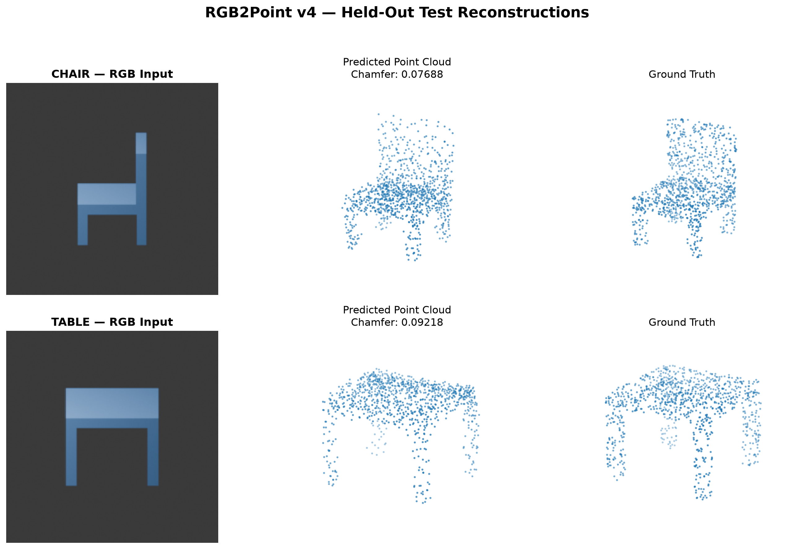

# RGB2Point: Single-View 3D Point Cloud Reconstruction

A single RGB image to **1,024 XYZ points** using a frozen pretrained Vision Transformer and a learnable-query Transformer decoder. The final v4 experiments use procedurally generated chairs and tables with **object-disjoint** train, validation, and test splits.

## Final held-out results

| Metric | Overall | Chair | Table |
|---|---:|---:|---:|
| Images | 16 | 8 | 8 |
| Chamfer Distance (lower is better) | **0.094976** | 0.078896 | 0.111056 |
| Predicted → ground truth | 0.046415 | 0.040590 | 0.052239 |
| Ground truth → predicted | 0.048561 | 0.038307 | 0.058816 |
| Coverage @ 0.02 | 10.18% | 13.21% | 7.15% |
| Coverage @ 0.05 | **63.04%** | 77.93% | 48.16% |
| Coverage @ 0.10 | 93.66% | 99.66% | 87.67% |
| Relative bounding-box dimension error | 11.19% | 11.69% | 10.69% |

**Test scope:** Two unseen procedural objects (one chair and one table), with eight rendered viewpoints each. These are not results on unseen real-world photographs or arbitrary object categories. The checkpoint was chosen using validation data, not the test set.

## Reconstruction examples



The predicted point clouds capture approximate chair/table structure, but points remain diffuse and fine geometry is not reliably recovered.

## Architecture

```text
RGB image (224 × 224 × 3)
  → frozen pretrained ViT-B/16 (`timm`: vit_base_patch16_224)
  → 196 patch tokens × 768 features (CLS token discarded)
  → linear projection 768 → 256
  → Transformer decoder, cross-attending to image patches
      • 1,024 learnable 256-D point queries
      • 2 decoder layers, 4 attention heads, 512-D feedforward
  → LayerNorm → Linear(256,128) → GELU → Linear(128,3)
  → predicted point cloud [batch, 1024, 3]
```

The pretrained image encoder is frozen and kept in evaluation mode. The projection, point queries, decoder, and output head are trained. See [`v4/models/rgb2point_v4.py`](v4/models/rgb2point_v4.py).

## Procedural dataset

Blender-based scripts generate **10 chair meshes and 10 table meshes**, sample **1,024 surface points per mesh**, and render **eight RGB views per object** (160 images total).

| Split | Unique objects | RGB images |
|---|---:|---:|
| Train | 14 | 112 |
| Validation | 4 | 32 |
| Test | 2 | 16 |

All views of a given object remain in the same split. Main dataset scripts:

- `v4/scripts/generate_procedural_meshes.py`
- `v4/scripts/sample_procedural_points.py`
- `v4/scripts/render_procedural_multiview.py`
- `v4/scripts/create_procedural_splits.py`
- `v4/scripts/dataset_v4.py`

The generated dataset is not committed to Git. Current scripts expect metadata at `../datasets/rgb2point_v4/metadata/procedural_{train,val,test}.json` relative to the repository root. The dataset's internal image/point-cloud paths must also match the metadata and loader. Blender is required to regenerate the meshes and renders.

## Training and model selection

| Setting | Value |
|---|---|
| Epochs | 50 |
| Batch size | 2 |
| Optimizer | AdamW |
| Learning rate | `1e-4` |
| Random seed | 42 |
| Input preprocessing | Bicubic resize to 224×224; tensor normalization with mean/std `(0.5,0.5,0.5)` |
| Training loss | Coverage-weighted Chamfer, weight 2.0 on GT → prediction |
| Checkpoint criterion | Minimum **unweighted** validation Chamfer Distance |
| Compute | Apple Silicon / PyTorch MPS; CPU fallback in scripts |

For predicted cloud P and ground-truth cloud G, the evaluation metric is the sum of the mean nearest-neighbor Euclidean distances in both directions:

```text
CD(P,G) = mean_{p∈P} min_{g∈G} ||p−g||₂
        + mean_{g∈G} min_{p∈P} ||g−p||₂

Training loss = predicted→GT + 2 × GT→predicted
```

The additional GT→prediction weight encourages coverage of the target surface. The selected baseline achieved **0.098957** best validation Chamfer Distance. See `v4/scripts/train_multiobject.py` and `v4/models/coverage_loss.py`.

## Experiments and ablations

The initial v1–v3 experiments used a limited Pix3D wardrobe subset and earlier architectures. They are retained as historical experiments, **not** evidence of general-category performance.

A v4 geometry-aware loss added a relative bounding-box dimension objective. On validation data:

| Model | Validation Chamfer ↓ | Relative dimension error ↓ |
|---|---:|---:|
| Coverage-weighted baseline | **0.098957** | 14.46% |
| Geometry-aware, dimension weight 0.100 | 0.102093 | **10.75%** |

The original baseline and geometry-aware runs used slightly different data-shuffling configurations, so this comparison is not perfectly controlled.

Additional dimension-weight experiments yielded:

| Dimension weight | Best validation Chamfer ↓ | Dimension error ↓ |
|---|---:|---:|
| 0.025 | 0.101222 | 13.12% |
| 0.050 | 0.100989 | 11.08% |
| 0.100 | 0.102093 | 10.75% |

The baseline was selected for final test evaluation because it had the lowest observed validation Chamfer Distance. Ablation scripts are in `v4/scripts/train_multiobject_ablation.py` and `v4/scripts/train_multiobject_geometry.py`.

## Setup and usage

Use **Python 3.11**. The project was run on macOS Apple Silicon with MPS. `requirements.txt` records the package versions in the working environment; a fresh cross-platform installation has not been independently validated. The earlier dependency list is preserved in `requirements_legacy.txt`.

```bash
python -m pip install -r requirements.txt
```

Prepare the procedural dataset in `../datasets/rgb2point_v4/` with the expected metadata and referenced files. From the **repository root**, ensure the output directory exists, then run:

```bash
mkdir -p v4/outputs
python -m v4.scripts.train_multiobject
python -m v4.scripts.evaluate_final_test
python -m v4.scripts.visualize_final_test
```

Training initializes the ViT encoder from pretrained TIMM weights, which may require an initial model download. It saves the best checkpoint to `v4/outputs/multiobject_best_model.pth`. Evaluation and visualization load that checkpoint with `pretrained=False`, then load its saved weights. **Checkpoints are not committed** due to their size, so evaluation requires a locally trained or compatible checkpoint.

The visualization script writes `v4/outputs/final_test_reconstructions.png`; the reported test metrics are recorded in `v4/outputs/final_test_results.log` locally.

### Standalone RGB-to-3D inference

Generate a 1,024-point 3D reconstruction from a single RGB image using a trained v4 checkpoint.

From the repository root:

```bash
python -m v4.scripts.predict --image path/to/image.png --checkpoint v4/outputs/multiobject_best_model.pth --output v4/outputs/prediction.ply --save-npy

```

The script resizes images to 224 x 224 and uses MPS when available (otherwise CPU).

The output is a 1,024-point ASCII PLY file. The --save-npy option also saves an array of shape (1024, 3).

A compatible trained checkpoint is required and is not included in GitHub.

Accuracy on arbitrary real-world photographs has not been validated.

For Blender dataset generation, see [Procedural Dataset Generation](v4/DATASET_GENERATION.md).


## Pix3D v3 experiment

An earlier RGB-to-point-cloud experiment uses a frozen pretrained ViT-B/16 with a fully connected point-cloud prediction head. This is a separate architecture from the v4 Transformer-decoder model.

- Dataset: Pix3D wardrobe category, with object-disjoint training, validation, and test splits.
- Held-out test set: 95 images from 2 unseen wardrobe models.
- Mean Chamfer Distance: **0.074602** (minimum 0.058843; maximum 0.092349).
- Mean CPU forward-pass inference time: **57.5 ms** in the local evaluation.
- Training: `train_pix3d_v3.py`; evaluation: `test_pix3d_v3.py`; dataset loader: `data_loaders/pix3d_dataset.py`.

These results are limited to a small wardrobe-only test set and are not a standard full-Pix3D benchmark. They should not be directly compared with v4 synthetic-test metrics. Pix3D data and trained checkpoints are not included in this repository; reproducing the results requires preparing the data, split annotations, and checkpoint.

## Repository guide

- `v4/models/` — final ViT–Transformer model and loss functions
- `v4/scripts/` — dataset generation, training, evaluation, ablations, visualization
- `v4/outputs/final_test_reconstructions.png` — representative held-out examples
- `models/`, `train_pix3d*.py`, `test_pix3d*.py`, `utils/` — earlier Pix3D work
- `requirements.txt` — current environment dependencies
- `requirements_legacy.txt`, `README_legacy.md` — preserved historical documentation

## Limitations and future work

- Only 20 unique procedural objects across two categories; the test set has just two unique objects.
- Synthetic renderings do not establish performance on real-world photos.
- Point clouds capture coarse shape but remain diffuse; fine surfaces and occluded details are challenging.
- Fixed output of 1,024 points; standalone inference is available, but accuracy on arbitrary real-world images remains unvalidated.
- Data and large checkpoints are excluded from the repository; exact reproduction requires regenerating the dataset and training.
- ShapeNetCore **was not used** in the reported experiments.

Future work includes larger object-disjoint datasets, real-image evaluation, stronger geometry priors, and more robust inference tooling.

## Author

**Riddhi Das** — project lead and primary developer.
