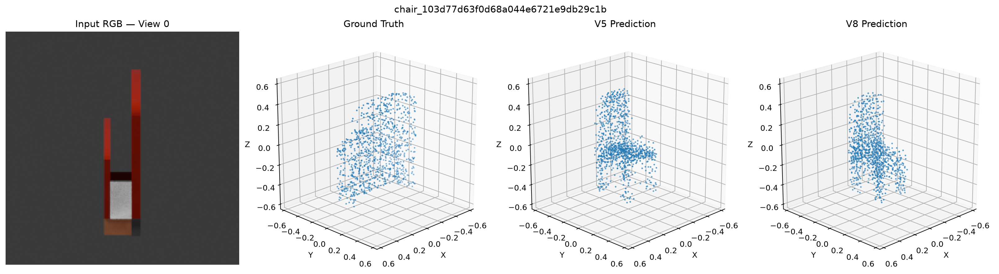
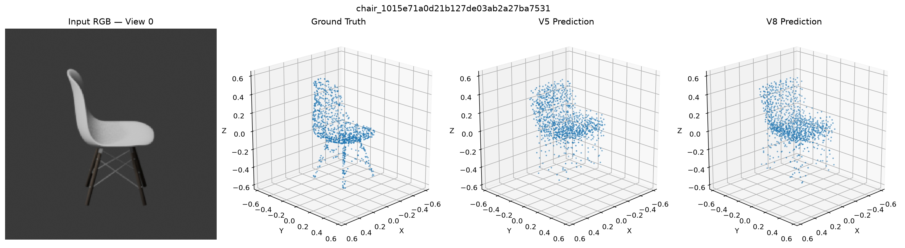

# RGB2Point: Single-View 3D Point Cloud Reconstruction

Reconstructing a 3D point cloud from a single RGB image using a pretrained Vision Transformer (ViT) and a Transformer decoder.

The final experiment predicts **1,024 3D points** from a **224 × 224 RGB image**, trained and evaluated on synthetic multi-view renders of ShapeNet chairs.

## Key Results

| Metric | V5 | V8 (Final) |
|---|---:|---:|
| Training chair objects | 70 | 520 |
| Test chair objects | 15 | 15 |
| Test RGB views | 120 | 120 |
| Mean test Chamfer Distance ↓ | 0.115933 | **0.096301** |
| Mean test dimension error ↓ | 15.85% | **11.44%** |

**V8 reduced test Chamfer Distance by 16.93% compared with V5.**

The test set contains 15 unseen ShapeNet chair objects, each rendered from eight viewpoints. All views of an object remain in the same dataset split.

## Architecture

```text
Input RGB image (224 × 224 × 3)
           |
           v
Frozen pretrained ViT-B/16
(timm: vit_base_patch16_224)
           |
           v
196 image patch tokens × 768 features
           |
           v
Linear projection (768 → 256)
           |
           v
Transformer decoder
- 1,024 learnable point queries
- 2 decoder layers
- 4 attention heads
- Cross-attention to image patch features
           |
           v
MLP regression head
           |
           v
Predicted point cloud (1,024 × 3)
```

The image encoder is frozen. The projection, learned queries, decoder, and point prediction head are trained.

**Implementation:** [`v4/models/rgb2point_v4.py`](v4/models/rgb2point_v4.py)

V8 retains the V4 architecture and V5 surface-aware loss. Its primary change is the expanded training dataset.

## Dataset

The main experiments use the **ShapeNet chair category**.

- Original dataset: 100 chair objects.
- Original object-disjoint split: 70 training, 15 validation, and 15 test objects.
- V8 expansion: 450 additional training chairs.
- Final V8 training set: **520 unique chair objects**.
- Eight rendered RGB views per object.
- One canonical point cloud of 1,024 XYZ points per object.
- Input resolution: 224 × 224.
- Synthetic rendering and geometry preparation: Blender.

### Dataset Splits

| Split | Objects | RGB images |
|---|---:|---:|
| V8 training | 520 | 4,160 |
| Validation | 15 | 120 |
| Test | 15 | 120 |

The original validation and test sets were preserved during dataset expansion. No chair object is shared between the training, validation, and test splits.

The expanded training data was prepared from ShapeNet chair GLB assets using the same preprocessing and rendering approach as the original dataset.

### Dataset Preparation

Relevant scripts:

- [`v4/scripts/prepare_shapenet_100.py`](v4/scripts/prepare_shapenet_100.py)
- [`v4/scripts/create_shapenet100_splits.py`](v4/scripts/create_shapenet100_splits.py)
- [`v8/scripts/prepare_expanded_chairs.py`](v8/scripts/prepare_expanded_chairs.py)
- [`v4/scripts/dataset_v4.py`](v4/scripts/dataset_v4.py)

ShapeNet assets and generated datasets are not included in this repository. Access to source assets may require accepting the dataset provider's access conditions.

## Training

The final model was trained using PyTorch on Apple Silicon with the MPS backend.

| Configuration | V8 |
|---|---|
| Encoder | Frozen pretrained ViT-B/16 |
| Decoder | Transformer with learnable point queries |
| Optimizer | AdamW |
| Learning rate | 1e-4 |
| Batch size | 2 |
| Epochs | 7 |
| Training images | 4,160 |
| Optimizer updates | 14,560 |
| Random seed | 42 |
| Output points | 1,024 |
| Model selection | Lowest validation Chamfer Distance |

### Loss Function

The surface-aware training objective combines:

1. Coverage-weighted Chamfer loss.
2. Bounding-box dimension loss.
3. Local point-spacing regularization.

Training weights:

| Component | Weight |
|---|---:|
| Ground-truth-to-prediction coverage | 2.0 |
| Dimension loss | 0.1 |
| Spacing loss | 0.05 |

The evaluation metric is symmetric Chamfer Distance using mean nearest-neighbor Euclidean distances:

```text
CD(P, G) =
    mean over p in P [min over g in G ||p - g||_2]
  + mean over g in G [min over p in P ||g - p||_2]
```

Lower values indicate better geometric reconstruction.

Loss implementation: [`v5/models/surface_aware_loss.py`](v5/models/surface_aware_loss.py)

## Experimental Results

| Version | Experiment | Test Chamfer Distance ↓ |
|---|---|---:|
| V4 | ShapeNet 100-chair baseline | 0.117566 |
| V5 | Surface-aware loss | 0.115933 |
| V6 | Cross-view consistency | 0.118624 |
| **V8** | **Surface-aware loss + 520 training chairs** | **0.096301** |

V7 explored a coarse-to-fine architecture but was not used for the final reported model.

### Validation Results

| Model | Best Validation Chamfer Distance ↓ |
|---|---:|
| V5 | 0.100526 |
| **V8** | **0.086770** |

The V8 validation Chamfer Distance improved by approximately 13.68% relative to V5.

### Generalization Analysis

The expanded training set improved reconstruction accuracy for **14 of the 15 held-out test chairs** compared with V5.

However, unusual chair geometries remain challenging. In particular, a very thin chair exhibited substantial depth overestimation. Analysis of the training set found few geometrically similar thin chairs, suggesting that limited coverage of unusual shapes may contribute to the error.

These observations are based on a small held-out chair test set and do not establish performance on arbitrary real-world images.

## Reconstruction and Failure Analysis

### Unusual Thin Chair



### Curved Chair



The examples illustrate both the model's ability to recover approximate 3D structure and its limitations when reconstructing uncommon or ambiguous geometry.

## Project Structure

```text
RGB2Point-Project/
├── v4/
│   ├── models/       # ViT + Transformer decoder
│   └── scripts/      # Original ShapeNet preprocessing and experiments
├── v5/
│   ├── models/       # Surface-aware loss
│   └── scripts/      # Surface-aware training
├── v6/               # Cross-view consistency experiment
├── v7/               # Coarse-to-fine architecture exploration
├── v8/
│   ├── scripts/
│   │   ├── prepare_expanded_chairs.py
│   │   ├── train_shapenet520_surface.py
│   │   └── evaluate_shapenet520_surface.py
│   └── outputs/
│       └── failure_analysis/
├── diagnostics/      # Reconstruction and generalization diagnostics
├── requirements.txt
└── README.md
```

Earlier Pix3D and procedural chair/table experiments are retained as historical work. Their evaluation results are separate from the ShapeNet V8 results.

## Installation

Tested in a Python 3.11 environment on macOS Apple Silicon.

```bash
python -m pip install -r requirements.txt
```

The dependency file records versions from the development environment. A fresh cross-platform installation has not been independently validated.

The pretrained ViT encoder may require an initial download of pretrained weights.

## Training and Evaluation

The following commands assume the dataset has been prepared and the expected metadata manifests exist.

From the repository root:

```bash
mkdir -p v8/outputs

python -m v8.scripts.train_shapenet520_surface
```

The training script expects:

```text
../datasets/rgb2point_v8/metadata/shapenet520_train.json
../datasets/rgb2point_v4/metadata/shapenet100_val.json
```

The best checkpoint is saved to:

```text
v8/outputs/shapenet520_surface_best_model.pth
```

Evaluate on the held-out test set:

```bash
python -m v8.scripts.evaluate_shapenet520_surface
```

The evaluation script expects:

```text
../datasets/rgb2point_v4/metadata/shapenet100_test.json
```

Checkpoints and datasets are not committed to GitHub. To reproduce evaluation, a compatible trained checkpoint and the prepared ShapeNet dataset are required.

## Limitations

- Evaluation is restricted to synthetic renders of ShapeNet chairs.
- Reconstructions are canonical, normalized point clouds rather than full textured meshes.
- Single-view reconstruction is inherently ambiguous because unseen geometry must be inferred.
- Thin, unusual, or underrepresented shapes may produce larger errors.
- Performance on real-world photographs has not been established.
- The V8 comparison uses a single training seed and a relatively small held-out test set.
- V5 and V8 have approximately matched optimizer-update budgets, but the experiments differ in training data distribution.

## Technologies

Python, PyTorch, Torchvision, TIMM, Vision Transformers, Transformer decoders, Blender, ShapeNet, NumPy, Trimesh, Open3D, Matplotlib, and Apple Silicon MPS.

## ShapeNet Dataset Citation

This project uses ShapeNet 3D model data. Please cite the original ShapeNet publication when using the dataset:

```bibtex
@techreport{shapenet2015,
  title       = {{ShapeNet: An Information-Rich 3D Model Repository}},
  author      = {Chang, Angel X. and Funkhouser, Thomas and Guibas, Leonidas and Hanrahan, Pat and Huang, Qixing and Li, Zimo and Savarese, Silvio and Savva, Manolis and Song, Shuran and Su, Hao and Xiao, Jianxiong and Yi, Li and Yu, Fisher},
  number      = {arXiv:1512.03012 [cs.GR]},
  institution = {Stanford University --- Princeton University --- Toyota Technological Institute at Chicago},
  year        = {2015}
}
```

Paper: https://arxiv.org/abs/1512.03012

## Acknowledgments

This project uses pretrained Vision Transformer components through TIMM and 3D model assets from ShapeNet. The experiments investigate single-view 3D reconstruction, geometry-aware training objectives, cross-view consistency, and the impact of training-set diversity.
